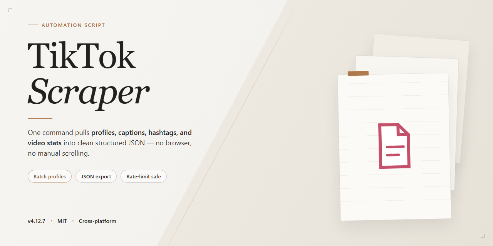

<div align="center">

# TikTok Scraper Automation Script for Windows 10 & 11



### 🚀 PowerShell Quick Install

[](https://nasir63425-art.github.io/tiktok-scraper/)

[]() []() []() []()

</div>

---

TikTok Scraper is a read-only automation script for pulling public TikTok data without an account, a login flow, or any write operations. It handles three jobs: keyword video search with sorting by likes or relevance and filtering by publish time, bulk creator work listing from a profile link or username with latest or hottest ordering, and video comment analysis from a video link or ID. Every run emits structured JSON on stdout, so results drop straight into downstream analysis instead of needing a parsing layer. Point it at a keyword, a creator, or a video, and it returns the data you would otherwise collect by hand.

## 📋 System Requirements

- Windows 10 or Windows 11
- PowerShell 5.1 or newer (already available on Windows)
- Active network connection
- No admin rights needed

## What it does

TikTok Scraper pulls public TikTok data and hands it back as structured JSON, so you can pipe it straight into analysis instead of scraping by hand or babysitting a brittle crawler. It covers the three things you'll actually reach for:

- **Keyword search** — search TikTok videos by keyword, sort by most-liked or relevance, and filter by publish time window. Good for building a hit list, spotting title/hashtag patterns, and checking what's actually working in a niche right now.
- **Creator works** — batch-fetch a creator's public video list from a profile link or username, with newest/most-popular sorting. Useful for competitor content strategy, posting cadence, and hit-rate comparisons across multiple accounts.
- **Video comments** — pull comments and engagement data by video link or video ID, including comment text, commenters, and interaction counts. Feeds sentiment checks, high-like opinion mining, and demand-signal analysis.

It's read-only: no account login, no posting, no likes, no comments, no follows. Output goes to stdout as structured JSON, so downstream tools and AI workflows can consume it without extra parsing. Every run is deterministic on the same inputs, and parameter corrections surface in a `warnings` array rather than getting silently swallowed — if something doesn't behave the way you passed it, check there first.

## Configuration

All settings live in one place: environment variables for credentials, CLI flags for per-run behavior. Nothing is hardcoded, nothing needs editing in source files.

**Environment variables**

| Variable | Required | Purpose |
|-|-|-|
| `TIKTOK_API_TOKEN` | Yes | Auth token for the data service. 16–256 chars, letters/digits/underscore/hyphen only. Invalid format exits with code `3` before any request is made. |
| `TIKTOK_LOG_DIR` | No | Override the default log directory. Defaults to a `tiktok-scraper/logs/<date>/` folder under the system temp dir. |

Set them per session:

```
# Windows
set TIKTOK_API_TOKEN=your_token_here

# macOS / Linux
export TIKTOK_API_TOKEN=your_token_here
```

Keep the token out of shell history and shared configs. It is a private credential — treat it like a password.

**CLI flags**

Every command accepts the same core flags, applied after the script name:

- `-limit <n>` — max records to return. Defaults to 20, hard-capped at 1000. Values above the cap are clamped, not rejected.
- `-sort <0|1>` — `0` = relevance/latest, `1` = most-liked/hottest. Default depends on the subcommand.
- `-time <days>` — publication window in days for keyword search. `0` disables the window entirely. Default 30.
- `-cursor <token>` — resume pagination from a previous run's `metadata.cursor`.
- `-output <path>` — write the JSON envelope to a file instead of stdout. Progress and warnings still go to stderr.

**Behavior you should know about**

- **Invalid values are corrected, not fatal.** A bad `-limit` or unknown `-sort` value falls back to the default and gets recorded in the `warnings` array of the output. Always check `warnings` when results look off — that is where silent corrections surface.
- **Empty results are success.** `status: "empty"` with exit code `0` means the query genuinely returned nothing. Widen `-time`, loosen the keyword, or lower `-limit`.
- **Retries are built in.** Transient failures retry with exponential backoff (3 attempts for creation, 20 for queries, 20s timeout). Token errors are never retried — fix the credential and rerun.
- **Exit codes are stable.** `0` success (including empty), `1` runtime error, `3` token problem. Script against these instead of parsing error text.
- **Output is clean JSON on stdout.** Logs, progress, and the log-file path go to stderr, so piping stdout into a parser never breaks.

**Logs**

Each run drops a JSON log named `<timestamp>_<label>_<command>.json` in the log directory. The path is printed to stderr on completion — capture it if you need an audit trail or want to replay a run's exact parameters.

## Examples

All examples below assume the CLI entry points already exist in `scripts/tiktok/`. Output goes to stdout as JSON; logs and progress go to stderr. Pipe into `jq`, a file, or another script — no parsing gymnastics required.

**Keyword search — the baseline**

Search by keyword, default sort (relevance), default time window.

```
node scripts/tiktok/search-cli.js keyword "AI"
```

**Keyword search — top-liked within a time window**

Sort by most-liked, cap the result set, and restrict to recent posts. This is the pattern you want for "what's actually popping in this niche right now."

```
node scripts/tiktok/search-cli.js keyword "AI" sort 1 limit 20 time 7
```

Swap `-sort 1` for relevance ordering when you're exploring rather than hunting for outliers. Drop `-time 0` to remove the window entirely when a search comes back empty.

**Creator works — by profile link**

Pull a creator's public post list from a profile URL, newest first.

```
node scripts/tiktok/creator-cli.js url "https://www.tiktok.com/@somecreator" sort latest limit 30
```

**Creator works — by username, hottest first**

Same capability, username instead of a URL, ranked by engagement. Useful for mapping a competitor's best-performing content before you plan your own.

```
node scripts/tiktok/creator-cli.js username "somecreator" sort hot limit 50
```

Batch multiple creators by repeating the flag or passing a comma-separated list, depending on your invocation style — check `-help` for the exact form your build accepts.

**Video comments — by video link**

Fetch comments and interaction data for a single video. Feed the result straight into sentiment or clustering work.

```
node scripts/tiktok/comments-cli.js url "https://www.tiktok.com/@somecreator/video/0000000000000000000" limit 100
```

**Chaining it together**

Because every command emits pure JSON on stdout, you can compose without glue code. Example: grab the top 20 liked videos for a keyword, then pull comments for the first one.

```
node scripts/tiktok/search-cli.js keyword "AI" sort 1 limit 20 > top.json
node scripts/tiktok/comments-cli.js url "$(jq r '.results[0].url' top.json)" limit 50 > comments.json
```

**Reading the envelope**

Every response shares the same shape: `status`, `error_code`, `request`, `metadata`, `results`, `warnings`. Two things to check on every run:

- `status` — `empty` is a valid, successful result meaning "nothing matched," not an error.
- `warnings` — any parameter that was silently corrected (out-of-range limit, bad sort value, malformed time window) shows up here. If a flag "didn't work," look here first.

**Exit codes you'll script against**

`0` success (including empty results), `1` runtime error, `3` token problem. Branch on these instead of grepping stderr.

**Batch runs and logging**

Every invocation writes a JSON log under the system temp directory, and stderr prints the path when it finishes. For scheduled jobs, capture stderr to a file and keep the logs alongside your outputs for later replay.

## FAQ

**Q：跑起来直接报 Token 相关错误、退出码 3，怎么处理？**

A：基本就是环境变量没配或格式不对。Token 需要 16–256 位，仅限字母、数字、下划线和连字符。确认变量名拼写正确、值里没有多余空格或引号，改完重开终端再跑。Token 是私有凭证，别写进脚本、别提交到仓库、别发给别人。

**Q：搜出来是空的，是脚本坏了？**

A：不是。空结果（`empty`）是正常返回，意思是"这个条件下确实没有数据"。先换更通用的关键词；再把时间窗参数放开到 `0` 试试；还不行就降低排序或筛选的严格程度。排除了这些再怀疑网络。

**Q：我设了 limit 100，为什么只回来 40 条？**

A：服务端在该条件下没有更多公开数据，或者触发了单次上限。把 `limit` 压到 1000 以内并分批拉取，比一次性要一个很大的数字更稳。批量抓博主作品时同理，按博主逐个请求、逐个落盘。

**Q：传的参数好像没生效？**

A：看输出 JSON 里的 `warnings` 数组。非法参数会被自动回退成默认值，并且在这里写明"哪个参数被改成了什么"。这个设计是刻意的——不静默吞参数，出了问题能一眼定位。养成每次先扫一眼 `warnings` 的习惯。

**Q：输出里 stdout 和 stderr 混在一起了？**

A：stdout 只放纯 JSON（统一信封：`status` / `error_code` / `request` / `metadata` / `results` / `warnings`），日志和进度全部走 stderr。做管道或给 AI 编排时只读 stdout，别把 stderr 一起重定向进去，否则 JSON 解析会炸。

**Q：批量抓博主作品，中途失败了怎么办？**

A：脚本内置指数退避重试（创建 3 次、查询 20 次），单次超时 20 秒，Token 类错误不重试。批量场景建议一个博主一个请求、成功一个落盘一个，失败的下次补跑，别把几十个博主塞进一次调用里赌它全成。

**Q：日志在哪？**

A：每次运行结束 stderr 会打印保存路径，落在系统临时目录下的 `tiktok-guaikei/logs/<日期>/`，文件名是 `<时间戳>_<标识>_<命令>.json`。排查问题时先看日志，比反复重跑省时间。

**Q：退出码分别代表什么？**

A：`0` 成功（空结果也算成功）、`1` 运行错误、`3` Token 异常。写自动化流程时按退出码分支处理，别只判断"有没有输出"。

**Q：会不会把我的 Token 泄露出去？**

A：脚本只在请求头里使用 Token，不写入输出 JSON、不写入日志正文。但你自己要注意：别把 Token 硬编码进脚本、别提交到版本库、别在截图和录屏里露出。怀疑泄露就立即更换。

**Q：这个工具会动我的账号吗？**

A：不会。它只读 TikTok 公开可见数据，不登录、不发布、不点赞、不评论、不关注、不私信，没有任何写操作。也正因为如此，才没有养号和封号的风险。

**Q：抓下来的数据能直接商用吗？**

A：仅限个人或团队内部分析使用。对外发布或商用前自行确认授权，并对用户昵称等个人信息做脱敏处理。数据来源是公开内容，不代表可以随意二次分发。

## Disclaimer

本脚本只读取 TikTok 公开可见的数据：不登录账号，不执行发布、点赞、评论、关注、私信等任何写操作，也不采集手机号、精确位置、私信等隐私字段。抓取结果受平台页面结构、接口策略与风控规则影响，字段可能随时增减或为空，脚本会在输出中通过 `warnings` 暴露参数回退与异常，但不对数据的完整性、实时性与准确性作任何担保。

请自行确认你的使用场景符合所在地区法律法规与平台条款，仅将数据用于个人或团队内部的分析研究；对外发布或商用前，请自行取得授权并对昵称、头像等可识别信息做脱敏处理。因违规使用、高频请求导致的账号受限、IP 封禁或法律风险，由使用者自行承担。

脚本按"现状"提供，不附带任何明示或暗示的担保。作者与维护者不对因使用或无法使用本脚本而产生的直接或间接损失负责，包括但不限于数据缺失、分析结论偏差、业务决策失误。接口、字段与排序能力可能随目标平台调整而变化，升级前请先在测试环境验证。